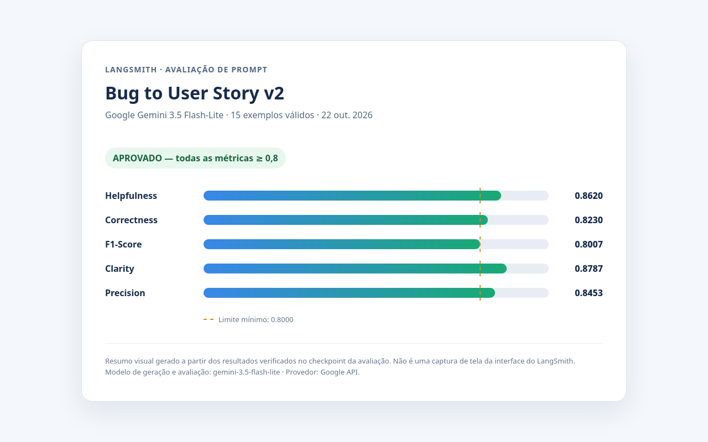

# Otimização de Prompts com LangChain e LangSmith

Fluxo para obter o prompt semente `leonanluppi/bug_to_user_story_v1`, manter uma versão otimizada em YAML, publicá-la no LangSmith Prompt Hub e avaliá-la no dataset de bugs fornecido.

## Requisitos

- Python 3.10 ou superior
- Conta e chave de API do LangSmith
- Chave de um provedor de modelos suportado (Google Gemini ou OpenAI)
- Um handle público do LangSmith Hub para publicar prompts

Crie e ative um ambiente virtual e instale as dependências:

```bash
python3 -m venv .venv
source .venv/bin/activate
pip install -r requirements.txt
```

No Windows, ative o ambiente com `.venv\Scripts\activate`.

## Configuração

Copie `.env.example` para `.env` se o arquivo local ainda não existir e preencha os valores necessários. `.env` é ignorado pelo Git; nunca publique chaves de API.

| Variável | Finalidade |
| --- | --- |
| `LANGSMITH_API_KEY` | Acesso ao LangSmith; necessária para pull, push e avaliação |
| `LANGSMITH_PROJECT` | Projeto de tracing e prefixo do dataset de avaliação |
| `USERNAME_LANGSMITH_HUB` | Handle público usado no nome publicado do prompt |
| `LLM_PROVIDER` | `google` ou `openai` |
| `GOOGLE_API_KEY` / `OPENAI_API_KEY` | Chave do provedor escolhido |
| `LLM_MODEL` | Modelo que gera as histórias |
| `EVAL_MODEL` | Modelo usado como avaliador pelas métricas |

Os nomes e versões de modelos disponíveis mudam. Consulte a documentação oficial do provedor e escolha modelos compatíveis com a configuração de temperatura utilizada pelo projeto.

Para obter um handle público, abra **Prompts** no LangSmith, escolha **Make Public** em um prompt e defina o handle. O handle escolhido é definitivo e deve ser configurado em `USERNAME_LANGSMITH_HUB`.

## Pull do prompt semente

```bash
python src/pull_prompts.py
```

O script faz pull de `leonanluppi/bug_to_user_story_v1`, habilita explicitamente `dangerously_pull_public_prompt=True` para esse prompt público conhecido e grava as mensagens no formato YAML do projeto em `prompts/bug_to_user_story_v1.yml`. A chave `LANGSMITH_API_KEY` precisa estar configurada.

## Técnicas Aplicadas (Fase 2)

O arquivo `prompts/bug_to_user_story_v2.yml` define mensagens System e User separadas, mantém `{bug_report}` como variável de entrada e exige respostas em português brasileiro.

- **Few-shot Learning:** dois exemplos completos mostram relatos e histórias de usuário esperadas, incluindo critérios de aceitação.
- **Skeleton of Thought:** uma estrutura Markdown fixa separa história, critérios, contexto técnico e informações a esclarecer.
- **Role Prompting:** a persona de Product Manager sênior orienta o nível de detalhe e a perspectiva da resposta.

As regras instruem o modelo a não inventar fatos, preservar valores e evidências, agrupar problemas relacionados e explicitar ambiguidades. O texto pede análise interna, mas não a exposição de raciocínio privado.

Valide o YAML e os requisitos do prompt:

```bash
pytest tests/test_prompts.py
```

## Publicação e avaliação

Depois de definir `USERNAME_LANGSMITH_HUB`, publique o prompt:

```bash
python src/push_prompts.py
```

O script valida o conteúdo, cria o `ChatPromptTemplate` a partir do YAML e publica `{USERNAME_LANGSMITH_HUB}/bug_to_user_story_v2` com visibilidade pública, descrição e tags que incluem as técnicas listadas.

Para avaliar o prompt com checkpoints por exemplo e retomada após interrupções, execute:

```bash
PYTHONPATH=src python -m src.evaluate_batches
```

A avaliação utiliza `datasets/bug_to_user_story.jsonl`, cria ou reutiliza o dataset `{LANGSMITH_PROJECT}-eval` e grava feedback de Helpfulness, Correctness, F1-Score, Clarity e Precision em experimentos LangSmith pequenos. Os checkpoints em `.evaluation-state/` são vinculados ao conteúdo do prompt, dataset, provedor e modelos; ao repetir o mesmo comando, exemplos concluídos são ignorados. Para executar em Windows PowerShell, defina `$env:PYTHONPATH = "src"` antes do comando `python -m src.evaluate_batches`.

## Resultados Finais

Avaliação final aprovada em **22/10/2026**, com o prompt publicado [`tiago-ferreira/bug_to_user_story_v2`](https://smith.langchain.com/prompts/bug_to_user_story_v2/4cacc78d?organizationId=46e00457-a918-4134-a810-a3041dbdd67f), provedor Google e `gemini-3.5-flash-lite` tanto para geração quanto para avaliação. Foram concluídos os 15 exemplos e cada métrica excedeu o limite de `0.8`:

| Métrica | Resultado | Limite |
| --- | ---: | ---: |
| Helpfulness | 0.8620 | 0.8 |
| Correctness | 0.8230 | 0.8 |
| F1-Score | 0.8007 | 0.8 |
| Clarity | 0.8787 | 0.8 |
| Precision | 0.8453 | 0.8 |



O PNG acima é um resumo visual gerado a partir do checkpoint verificado, não uma captura da interface do LangSmith. O arquivo-fonte do resumo está em `evidence/final-evaluation-summary.html`.

O dataset foi compartilhado publicamente de forma intencional: [abrir dataset de avaliação no LangSmith](https://smith.langchain.com/public/20d6c506-d050-4d26-8685-017966643cdb/d).

Links para todos os experimentos de lote da avaliação final:

1. [Exemplo 1](https://smith.langchain.com/o/46e00457-a918-4134-a810-a3041dbdd67f/datasets/7c5289b6-5d1b-4d41-a945-1f0cb6077a76/compare?selectedSessions=e57ef57b-90ce-48bb-955b-ce1cd517ede6)
2. [Exemplo 2](https://smith.langchain.com/o/46e00457-a918-4134-a810-a3041dbdd67f/datasets/7c5289b6-5d1b-4d41-a945-1f0cb6077a76/compare?selectedSessions=4057ce26-11d5-4cd1-aabe-350a4f550d9c)
3. [Exemplo 3](https://smith.langchain.com/o/46e00457-a918-4134-a810-a3041dbdd67f/datasets/7c5289b6-5d1b-4d41-a945-1f0cb6077a76/compare?selectedSessions=b4584fe2-ada1-40b4-b1a4-5dc1822ea336)
4. [Exemplo 4](https://smith.langchain.com/o/46e00457-a918-4134-a810-a3041dbdd67f/datasets/7c5289b6-5d1b-4d41-a945-1f0cb6077a76/compare?selectedSessions=cb071732-bc9d-4bc5-a86c-4daf0ed690c2)
5. [Exemplo 5](https://smith.langchain.com/o/46e00457-a918-4134-a810-a3041dbdd67f/datasets/7c5289b6-5d1b-4d41-a945-1f0cb6077a76/compare?selectedSessions=fef50703-c4e5-4b0b-9589-3d4758a812ac)
6. [Exemplo 6](https://smith.langchain.com/o/46e00457-a918-4134-a810-a3041dbdd67f/datasets/7c5289b6-5d1b-4d41-a945-1f0cb6077a76/compare?selectedSessions=a4992956-cf40-4348-938c-9991f0a0a528)
7. [Exemplo 7](https://smith.langchain.com/o/46e00457-a918-4134-a810-a3041dbdd67f/datasets/7c5289b6-5d1b-4d41-a945-1f0cb6077a76/compare?selectedSessions=bec30d92-aa89-4b4f-856d-bcdcd64e3bd8)
8. [Exemplo 8](https://smith.langchain.com/o/46e00457-a918-4134-a810-a3041dbdd67f/datasets/7c5289b6-5d1b-4d41-a945-1f0cb6077a76/compare?selectedSessions=6927443a-7356-42f7-90b6-b61e150990bf)
9. [Exemplo 9](https://smith.langchain.com/o/46e00457-a918-4134-a810-a3041dbdd67f/datasets/7c5289b6-5d1b-4d41-a945-1f0cb6077a76/compare?selectedSessions=1e3acdb9-962b-403b-8b02-df1aad11b093)
10. [Exemplo 10](https://smith.langchain.com/o/46e00457-a918-4134-a810-a3041dbdd67f/datasets/7c5289b6-5d1b-4d41-a945-1f0cb6077a76/compare?selectedSessions=d102e31d-f84f-42d4-9f82-e385a4bbfa14)
11. [Exemplo 11](https://smith.langchain.com/o/46e00457-a918-4134-a810-a3041dbdd67f/datasets/7c5289b6-5d1b-4d41-a945-1f0cb6077a76/compare?selectedSessions=dfbf08f5-11f1-46e7-ad27-91b63a4d3caa)
12. [Exemplo 12](https://smith.langchain.com/o/46e00457-a918-4134-a810-a3041dbdd67f/datasets/7c5289b6-5d1b-4d41-a945-1f0cb6077a76/compare?selectedSessions=1586b1fd-8240-497d-8c6f-e45f91b75cee)
13. [Exemplo 13](https://smith.langchain.com/o/46e00457-a918-4134-a810-a3041dbdd67f/datasets/7c5289b6-5d1b-4d41-a945-1f0cb6077a76/compare?selectedSessions=84e7052e-4546-4a50-aa2f-3b5d39f1fa4c)
14. [Exemplo 14](https://smith.langchain.com/o/46e00457-a918-4134-a810-a3041dbdd67f/datasets/7c5289b6-5d1b-4d41-a945-1f0cb6077a76/compare?selectedSessions=c511b805-029a-4f76-b983-d52aedd53857)
15. [Exemplo 15](https://smith.langchain.com/o/46e00457-a918-4134-a810-a3041dbdd67f/datasets/7c5289b6-5d1b-4d41-a945-1f0cb6077a76/compare?selectedSessions=7663da09-9972-4a77-9d1c-f5edcd887f15)

Os links de três exemplos para inspeção dos traces:

- [Trace do exemplo 1](https://smith.langchain.com/o/46e00457-a918-4134-a810-a3041dbdd67f/datasets/7c5289b6-5d1b-4d41-a945-1f0cb6077a76/compare?selectedSessions=e57ef57b-90ce-48bb-955b-ce1cd517ede6)
- [Trace do exemplo 2](https://smith.langchain.com/o/46e00457-a918-4134-a810-a3041dbdd67f/datasets/7c5289b6-5d1b-4d41-a945-1f0cb6077a76/compare?selectedSessions=4057ce26-11d5-4cd1-aabe-350a4f550d9c)
- [Trace do exemplo 3](https://smith.langchain.com/o/46e00457-a918-4134-a810-a3041dbdd67f/datasets/7c5289b6-5d1b-4d41-a945-1f0cb6077a76/compare?selectedSessions=b4584fe2-ada1-40b4-b1a4-5dc1822ea336)

Para compartilhar deliberadamente o dataset depois de criar os experimentos, use:

```python
from langsmith import Client

print(Client().share_dataset(
    dataset_name="<LANGSMITH_PROJECT>-eval"
)["url"])
```

O compartilhamento é uma ação explícita, separada da avaliação. Não publique links ou capturas até confirmar que não expõem dados ou credenciais.

## Arquivos que devem permanecer inalterados

`src/evaluate.py`, `src/metrics.py`, `src/utils.py` e `datasets/bug_to_user_story.jsonl` são entradas fornecidas pelo desafio. As alterações desta implementação concentram-se nos scripts de pull/push, no prompt v2, nos testes e nesta documentação.
